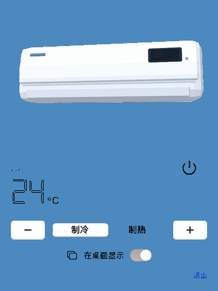

# CuteAC：macOS 菜单栏小空调

低多边形卡通空调，常驻 macOS 菜单栏，也可以透明地放在桌面上。纯原生 Swift 实现（AppKit、SwiftUI、SceneKit），不用任何 WebView，目标是**极致省电**。



## 功能

- **菜单栏弹窗**：3D 空调可以拖动旋转，支持开关机、调温度（16–31°C）、切换制冷和制热。
- **真实感细节**：导风板会开合；显示窗用数码管字体（Digital-7 Mono，和网页组件同一款字体）实时显示温度，背后有暗着的“88”底纹；指示灯随模式变色。
- **出风效果**：制冷时飘雪花，制热时吹暖风线。
- **桌面挂件**：在弹窗里打开“在桌面显示”，会出现一个透明无边框的窗口，只露出空调本体，默认位于桌面图标上方、普通窗口下方。
  - 拖动：移动位置，位置会被记住
  - 双击：开关机
  - 右键：始终置顶、隐藏挂件
- **状态持久化**：状态保存在 `UserDefaults` 里，数据结构和 `@yunlefun-home/air-conditioner` 的 core 一致。

## 运行

```bash
scripts/bundle.sh          # 构建 build/CuteAC.app（不在 Dock 显示，只在菜单栏）
open build/CuteAC.app
```

调试参数：

| 参数 | 作用 |
|---|---|
| `--show-popover` | 启动后自动打开弹窗，用于测量弹窗打开时的开销 |
| `--show-pet` | 启动后显示桌面挂件 |
| `--snapshot <dir>` | 离屏渲染三种状态的 PNG 后退出，用于检查模型和光照 |
| `--realitykit` / `--realitykit-renderer` | 实验性的 RealityKit 渲染路径（macOS 15+），见 [RealityKit 迁移评估](docs/realitykit-spike.md)。可以和 `--snapshot` 一起用 |
| `--bench-cycle` | 每 1.5 秒切换一次开关机，用于测量状态切换动画的开销 |
| `--blink-popover` | 打开弹窗 2.5 秒后关闭，用于测量弹窗关闭后的开销 |
| `--capture <dir>` | 打开弹窗，按脚本演示一遍（开机 → 调温 → 制热 → 关机），从运行中的视图逐帧导出 PNG 后退出。不需要屏幕录制权限 |

重新生成文档里的 GIF：

```bash
build/CuteAC.app/Contents/MacOS/CuteAC --capture /tmp/cute-ac
ffmpeg -framerate 15 -i /tmp/cute-ac/frame-%03d.png \
  -vf "scale=360:-1:flags=lanczos,split[a][b];[a]palettegen=stats_mode=diff[p];[b][p]paletteuse=dither=bayer:bayer_scale=4" \
  /tmp/cute-ac/demo.gif
gifsicle -O3 --lossy=35 --colors 128 /tmp/cute-ac/demo.gif -o ../../docs/public/macos/demo.gif
```

文档截图用 WebP（`cwebp -q 86 -m 6`），比 PNG 小约 65%。`Model/renders/` 不入库，需要时用 Blender 脚本重新生成。

## 模型

`Model/build_cute_ac.py` 是 Blender 脚本，模型完全由代码生成，可以重复构建：

```bash
/Applications/Blender.app/Contents/MacOS/Blender -b -P Model/build_cute_ac.py
```

- 输出 `Sources/CuteAC/Resources/CuteAC.usdz` 给应用使用，同时在 `Model/renders/` 生成预渲染图，以后可以给 WidgetKit 小组件用。
- 外形参照真实壁挂空调：顶部进风格栅、分成三个斜面的前面板、底部出风口和导风板、右侧显示窗。全部用平面着色，保留低多边形的棱角感。
- 应用会控制这几个命名节点：`Louver`（导风板，转轴在顶边）、`Display`（UV 为 0–1 的平面，用来贴温度画面）、`Led`（指示灯）。改模型时请保持这些名字不变。
- 坐标约定：导出时已转换成 Y 轴朝上，但每个节点内部仍沿用 Blender 的局部坐标轴（Z 轴朝上）。

## 省电设计

| 手段 | 说明 |
|---|---|
| 平时不渲染 | `rendersContinuously = false`。只在状态切换的约 0.7 秒内打开 `isPlaying`，之后 SceneKit 完全不画。 |
| 没人看就暂停 | 弹窗关闭并且桌面挂件隐藏时，`scene.isPaused = true`。 |
| 光照模型简单 | 用 Lambert 平面着色，不用 PBR，也不用环境贴图和阴影。 |
| 出风效果交给系统 | 雪花和风线用循环的 `CABasicAnimation`，由系统的渲染进程执行，应用进程不做逐帧计算。最早的 `CAEmitterLayer` 版本在弹窗打开时 CPU 约 10%，已经替换掉。 |
| 显示窗只在变化时重绘 | 温度贴图只在状态改变时画一次。 |

## 实测（Apple Silicon，macOS 26，`top` 采样）

| 状态 | CPU | 内存 | 能耗 |
|---|---|---|---|
| 关机，弹窗关闭 | 0.0% | 22 MB | 0.0 |
| 开机，弹窗关闭 | 0.1% | 23 MB | 0.1 |
| 关机，弹窗打开 | 0.1% | 42 MB | 0.1 |
| 制冷，弹窗打开，雪花在飘 | 0.0% | 42 MB | 0.0 |
| 制冷，只显示桌面挂件 | 0.1% | 34 MB | 0.1 |

## 字体

`Sources/CuteAC/Resources/digital-7-mono.ttf` 复制自 `packages/vue/public/assets/fonts/`，授权和网页组件里的那份相同。Digital-7 是 Style-7 发布的免费字体，商业分发前请先确认它的授权条款。

## 后续

- 接入 YunLeFun/home 的真实设备绑定，从 Home Assistant 读取并控制真实空调。令牌存在钥匙串里。
- WidgetKit 小组件：每种状态用一张 `Model/renders` 里的预渲染图片。
- 签名、公证并发布 Release。
