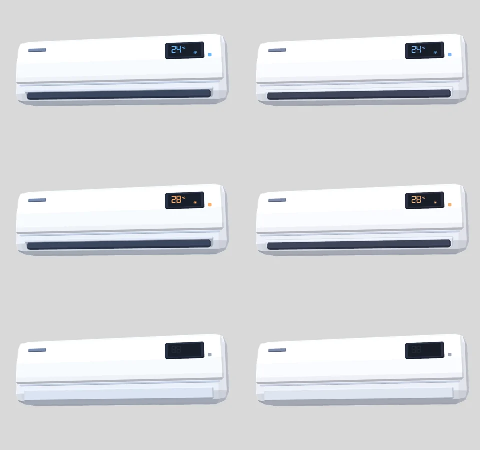

# RealityKit 迁移评估与渲染器选型

> 评估日期：2026-10-16。环境：MacBook Pro（Apple M1 Pro，ProMotion 屏幕），macOS 26.6，Xcode 27.0（Swift 6.4），`swift build -c release`。
> 实验代码没有合并进 `dev`，保存在 tag [`spike/realitykit`](https://github.com/YunYouJun/air-conditioner/tree/spike/realitykit)（提交 `bed96bd`，来自已关闭的草稿 PR [#173](https://github.com/YunYouJun/air-conditioner/pull/173)）。下文提到的实验文件和启动参数都只存在于这个 tag 里。

## 选型决策

**决定：继续用 SceneKit，暂不迁移到 RealityKit；迁移会做，但要等到触发条件出现。**（2026-10-16）

### 背景

Apple 在 WWDC25 宣布 SceneKit 在所有平台上软弃用，进入维护模式：不再加新功能，只修关键问题，推荐新项目用 RealityKit。软弃用不会产生编译警告，现有 API 照常可用。

### 为什么长期要迁

- SceneKit 不会再有新能力，Apple 的投入都在 RealityKit 上。
- 迟早会出现正式的弃用警告，甚至在某个系统版本上出问题，那时再迁会比较被动。

### 为什么现在不迁

- **离被迫迁移还早**。OpenGL 在 2018 年宣布弃用，到现在 macOS 上还能用。SceneKit 目前连编译警告都没有，这么小的应用几年内大概率不受影响。
- **现在迁移对用户没有好处，反而有代价**：`RealityView` 静止时 CPU 约 30%；`RealityRenderer` 按需渲染虽然省电，但内存是 SceneKit 的 5 倍，还要放弃 macOS 14 用户、自己维护渲染循环。这和项目“极致省电”的目标正好相反。
- **RealityKit 每年都在变**。最可能补上的正是按需渲染或暂停。现在照着变通方案迁过去，等 Apple 补上 API 后很可能还要再改一遍；等一等，可能只需要迁一次。
- **以后的迁移成本已经摸清楚了**。外观、离屏渲染、省电方案都验证过，代码保存在 tag 里，晚一点迁成本不会高多少。

### 迁移的触发条件

出现下面任意一条，就重新评估并开始迁移：

1. `RealityView` 支持按需渲染、暂停或帧率控制。
2. SceneKit 出现正式的 `deprecated` 编译警告，或者在新系统上出问题。
3. RealityKit 在 macOS 上的基础内存明显下降（现在只要创建渲染器就约 200 MB）。
4. 计划做 visionOS 版，或者需要 RealityKit 独有的能力。这时应该提前迁移，直接用 RealityKit 写。

迁移时优先用 `RealityRenderer` 按需渲染的方案（烘焙光照 + `CAMetalLayer`），这次已经验证过它的外观和省电表现。

### 在那之前

- **新功能不要深度绑定 SceneKit**：不引入 `SCNParticleSystem`、`SCNTechnique`、物理效果等。特效继续用 Core Animation 叠加层，它和渲染器无关，迁移时可以直接复用。
- **保持模型约定**：继续用 USDZ，保留 `Louver` / `Display` / `Led` 这几个节点名，两边都能用。
- **每年 WWDC 之后复查一次**：用新 SDK 编译运行 `spike/realitykit`，重测下面的功耗对比，看触发条件有没有满足，并把结果补充到本文档。
- **离线渲染可以先用 RealityKit**：比如 WidgetKit 小组件需要的各状态预渲染图，可以参考 tag 里的 `RKSnapshot.swift` 一次性渲染出来，不在常驻界面里引入 RealityKit。

## 评估结论

**能迁移，但现在不建议迁移。**

- **功能上能完整复现**：模型加载、拖动旋转、导风板开合、显示窗温度贴图、指示灯颜色、透明背景、出风效果、离屏截图都做出来了，外观和 SceneKit 几乎一样（见下方对比图）。
- **`RealityView` 做不到“静止时完全不渲染”**：只要视图存在，它就按屏幕刷新率一直画。弹窗打开但什么都不动时 CPU 约 **30%**，是 SceneKit（约 0.03%）的上千倍；**弹窗关掉以后也还是 30%**，因为 SwiftUI 不会销毁弹窗里的视图。内存约 **235 MB**（SceneKit 约 40 MB）。`RealityView` 没有暂停、按需渲染或帧率之类的 API，对这个项目“极致省电”的目标来说不能接受。
- **绕开 `RealityView`、自己用 `RealityRenderer` 按需渲染可以做到静止 0 CPU**（第二个实验路径 `--realitykit-renderer`）：静止时和 SceneKit 一样约 0.0–0.2%，状态切换时约 5%（SceneKit 约 2%）。但内存仍然约 **200 MB**，是 SceneKit 的 5 倍；而且渲染循环、`CAMetalLayer`、手势都要自己写，等于自己维护一个小渲染器。
- **最低系统版本**：`RealityView` 和 `RealityRenderer` 都要 macOS 15。全面迁移需要把最低版本从 14 提到 15；实验路径用 `@available` 包住，现在不用改。
- **建议**：继续用 SceneKit，等 Apple 给 `RealityView` 加上按需渲染或暂停的能力，或者 SceneKit 真的出现弃用警告时再迁移。到时候优先走 `RealityRenderer` 按需渲染的方案。详见文末“建议”。

## 实验路径

以下代码都在 tag `spike/realitykit` 里，复查时先 `git checkout spike/realitykit`。

有两个实验路径，都用启动参数切换，都需要 macOS 15（低于 15 时自动回退到 SceneKit）：

- `--realitykit`：SwiftUI `RealityView`，这是 Apple 推荐的写法。
- `--realitykit-renderer`：`RealityRenderer` 按需渲染到 `CAMetalLayer`，只在状态切换（30 fps，持续 0.7 秒）、拖动、尺寸变化时画一帧，和 SceneKit 现在的 `isPlaying` 做法一样。这是在发现 `RealityView` 停不下来之后补做的。

```bash
scripts/bundle.sh
build/CuteAC.app/Contents/MacOS/CuteAC --realitykit --show-popover
build/CuteAC.app/Contents/MacOS/CuteAC --realitykit-renderer --show-pet
build/CuteAC.app/Contents/MacOS/CuteAC --realitykit --snapshot /tmp/cute-ac-rk   # 离屏渲染
```

| 文件 | 作用 |
|---|---|
| `Sources/CuteAC/RenderBackend.swift` | `RenderBackend` 解析启动参数；`ACRenderHost` 持有渲染器状态，RealityKit 路径下不会创建 SceneKit 场景；`ACModelView` 按后端选择视图 |
| `Sources/CuteAC/RealityKit/RKACModel.swift` | 只加载一次 `CuteAC.usdz`，把 SceneKit 的 Lambert 光照烘焙成逐面的 `UnlitMaterial` 颜色，作为模板 |
| `Sources/CuteAC/RealityKit/RKACRig.swift` | 每个视图一份模型克隆，负责 `Louver` 开合、`Display` 贴图、`Led` 颜色、开机弹跳；`RKCamera` 复现 SceneKit 的相机和转台式旋转 |
| `Sources/CuteAC/RealityKit/RKACView.swift` | `RealityView` 版本的 3D 视图，拖动旋转相机；出风效果继续用 Core Animation 叠加层 |
| `Sources/CuteAC/RealityKit/RKRendererView.swift` | `--realitykit-renderer`：`RealityRenderer` + `CAMetalLayer` 按需渲染，鼠标拖动转相机 |
| `Sources/CuteAC/RealityKit/RKSnapshot.swift` | `--snapshot` 的 RealityKit 版本，用 `RealityRenderer` 渲染到 Metal 纹理 |

对现有代码的改动只有接线：`PopoverView`、`DesktopPetView`、`AppDelegate` 改为通过 `ACRenderHost` / `ACModelView` 取视图；出风叠加层的生成逻辑从 `ACSceneContainerView` 的实例方法提成静态方法 `populateAirflow`，供两个后端共用，SceneKit 的行为不变。另外新增两个测量用的调试参数：`--bench-cycle`（每 1.5 秒切换一次开关机，测状态切换动画的开销）和 `--blink-popover`（打开弹窗 2.5 秒后关闭，测弹窗关闭后还剩多少开销）。

### 复现情况

| 功能 | SceneKit 现状 | RealityKit 实验版 | 结果 |
|---|---|---|---|
| 加载模型 | `SCNScene(url:)` | `Entity(contentsOf:)`（异步） | ✅ 节点名 `Louver` / `Display` / `Led` 原样保留 |
| 平面着色 | Lambert 光照模型 + 环境光、主光、补光 | 加载时按 SceneKit 的三盏灯算出每个面的 Lambert 颜色，按颜色拆分网格，每种颜色一个 `UnlitMaterial`；不用灯光、IBL 或 PBR | ✅ 离屏截图与 SceneKit 逐像素对比，各通道差异在几个色阶以内（见下图） |
| 导风板开合 | `SCNTransaction` 隐式动画 0.5 秒 | `Entity.move(to:relativeTo:duration:timingFunction:)` | ✅ |
| 开机弹跳 | `SCNAction` 序列 | 两段 `move`（缩放） | ✅ |
| 显示窗温度 | `diffuse.contents = NSImage`，constant 光照 | `UnlitMaterial` + `TextureResource`，状态变化时 `replace(withImage:)` 原地更新 | ✅ UV 方向一致 |
| 指示灯颜色 | constant 光照的 diffuse 颜色 | `UnlitMaterial` 颜色 | ✅ |
| 拖动旋转 | `allowsCameraControl` + `.orbitTurntable`，竖直 ±25° | 自己写拖动手势转动相机，竖直 ±25°（`RealityView` 用 `DragGesture`，按需渲染版用 `mouseDragged`） | ⚠️ 已实现，但没法在本机自动点击验证手感 |
| 透明背景 | `backgroundColor = .clear` | `RealityView` 背后的 `CAMetalLayer` 不是 opaque，背景透明；按需渲染版清屏为透明，读回像素确认四角 alpha 为 0 | ✅ |
| 出风效果 | Core Animation 叠加层，位置用 `projectPoint` 算 | 同一个叠加层，位置用相机参数自己投影 | ✅ 与渲染器无关，可以直接复用 |
| `--snapshot` 离屏渲染 | `SCNRenderer.snapshot` | `RealityRenderer` → `MTLTexture` → PNG | ✅ 本机约 0.9 秒出三张图 |
| `--capture` 演示录制 | `cacheDisplay` 抓视图层级 | 没有实现 | ❌ `cacheDisplay` 抓不到 Metal 图层，需要重做 |



左列 SceneKit，右列 RealityKit，都是 `--snapshot` 的离屏渲染结果，从上到下依次是制冷、制热、关机。

## 功耗对比

测量方法和 README「实测」一致：每个场景都重新启动 `build/CuteAC.app`，等 6 秒，然后 `top -l 22 -s 1 -stats pid,cpu,mem,power,idlew -pid <pid>`，丢掉前 2 个采样，取后 20 秒的平均值（括号里是峰值）。每次测量前用 `defaults write` 设好开关机状态，测完删除测试写入的设置。本机 `top` 的 POWER 列与 CPU 列逐项相同，下表只列 CPU 和内存；空闲唤醒（IDLEW）三者都在 0–1 次/秒，没有差别。

| 状态 | SceneKit（默认） | RealityView（`--realitykit`） | RealityRenderer 按需（`--realitykit-renderer`） |
|---|---|---|---|
| 关机，弹窗关闭 | 0.01%，25 MB | 0.01%，12 MB | 0.00%，12 MB |
| 开机，弹窗关闭 | 0.01%，25 MB | 0.00%，13 MB | 0.00%，13 MB |
| 关机，弹窗打开，静止 | 0.25%（3.5%），41 MB | **31.3%**（35.5%），235 MB | 0.23%（2.6%），205 MB |
| 制冷，弹窗打开，雪花在飘 | 0.03%（0.7%），40 MB | **29.1%**（34.4%），235 MB | 0.20%（3.3%），207 MB |
| 弹窗打开，每 1.5 秒开关机一次 | 2.24%（3.2%），44 MB | **31.6%**（73.7%），237 MB | 5.46%（11.4%），213 MB |
| 制冷，弹窗打开后再关闭 | 0.12%（1.5%），42 MB | **29.3%**（38.2%），233 MB | 0.09%（0.7%），206 MB |
| 制冷，只显示桌面挂件 | 0.01%（0.1%），30 MB | **29.3%**（45.8%），226 MB | 0.00%（0.0%），196 MB |
| 只显示桌面挂件，每 1.5 秒开关机一次 | 1.71%（4.4%），39 MB | **30.4%**（33.8%），227 MB | 4.63%（6.4%），206 MB |

解读：

- **静止时能不能完全不渲染**：SceneKit 能（`rendersContinuously = false`，只在切换时短暂打开 `isPlaying`）。`RealityView` **不能**：没有任何暂停或按需渲染的 API，静止时也一直按屏幕刷新率渲染，所以“弹窗打开静止”“桌面挂件静止”“状态切换中”三种情况的 CPU 都差不多是 30%。`RealityRenderer` 按需渲染**能**，静止时和 SceneKit 一样接近 0。
- **弹窗关闭后**：SceneKit 靠 `scene.isPaused` 停下来。`RealityView` 在弹窗关闭（窗口移出屏幕）后**仍然持续 30% CPU**，要停下来只能在不可见时把 `RealityView` 从视图树里移除，代价是每次打开都要重新异步加载模型，可能闪一下。按需渲染版在窗口离开屏幕时不画，没有这个问题。
- **状态切换**：按需渲染版在 0.7 秒的动画窗口里以 30 fps 渲染，平均 CPU 约是 SceneKit 的 2.5 倍（5.5% 对 2.2%），每次切换还会重新上传一张 250×100 的显示窗贴图。
- **内存**：只要创建了任何 RealityKit 渲染器，进程内存就从约 40 MB 涨到约 200 MB，按需渲染版也一样，这是 RealityKit 引擎本身的固定开销，和模型大小无关。弹窗关闭时 RealityKit 版本反而更低（12 MB 对 25 MB），只是因为 SceneKit 版在启动时就加载了场景，而 RealityKit 版要等第一次显示才加载。

## 最低系统版本

在本机 SDK 的 `.swiftinterface` 中查到的可用版本：

| API | macOS 最低版本 | 用途 |
|---|---|---|
| `RealityView`、`RealityViewCameraContent`（`camera = .virtual`、`renderingEffects`、`environment`） | 15.0 | SwiftUI 里的 3D 视图 |
| `realityViewCameraControls(.orbit)` / `CameraControls` | 15.0 | 系统自带的相机控制（本次没用，见下文） |
| `RealityRenderer` | 15.0 | 离屏渲染，替代 `SCNRenderer` |
| `TextureResource(image:options:)`（异步）、`UnlitMaterial(applyPostProcessToneMap:)`、`MeshResource(from: Contents)`（异步） | 15.0 | 贴图、材质、重建网格 |
| `RealityViewCameraContent.animate(body:completion:)`、`realityViewLayoutBehavior` | 26.0 | 更方便的动画和布局，本次没用 |
| `ARView`（AppKit，非 AR 模式） | 10.15 | 旧接口，可以在 macOS 14 上用，但功能停在 RealityKit 2 时代，不建议新代码依赖 |

- 现在 `Package.swift` 是 `.macOS(.v14)`，`bundle.sh` 写的 `LSMinimumSystemVersion` 是 14.0。实验路径全部用 `@available(macOS 15, *)` 包住，所以**不需要改最低版本**也能编译，macOS 14 上会回退到 SceneKit。
- 如果把 RealityKit 作为唯一渲染器，就必须把 `Package.swift` 改成 `.macOS(.v15)`，同时把 `bundle.sh` 里的 `LSMinimumSystemVersion` 改成 15.0，也就是放弃 macOS 14（Sonoma）用户。

## `--snapshot` 在 RealityKit 下的替代

- 用 `RealityRenderer`：创建渲染器，加入模型和相机实体，`updateAndRender(deltaTime:cameraOutput:onComplete:)` 渲染到 `bgra8Unorm_srgb` 的 `MTLTexture`，再读回像素写 PNG。整个过程不需要窗口，和 `SCNRenderer` 一样可以在命令行里跑。
- **坑**：`UnlitMaterial(applyPostProcessToneMap: false)` 的意思是“材质预先补偿掉色调映射”，所以渲染器必须**保持** `cameraSettings.isToneMappingEnabled = true`（默认值）。如果关掉色调映射，线性 0.1 的颜色会输出成 0.14，1.0 会变成 2.0，整体偏亮。这一点文档里没有写，是实测出来的。
- `RealityRenderer` 的创建、渲染完成回调都是异步的，所以 `main.swift` 里 RealityKit 分支改成 `Task` + `dispatchMain()`。
- CI（PR #172 的 `.github/workflows/macos.yml`，`macos-latest` 虚拟机）里还没验证过 `RealityRenderer`。GitHub 的 macOS 虚拟机有半虚拟化 GPU，`SCNRenderer` 能跑，`RealityRenderer` 理论上也能跑，但没实测。建议先在工作流里加一步 `--snapshot "$RUNNER_TEMP/snap-rk" --realitykit`，设 `continue-on-error: true` 观察几次再决定。

## 需要放弃或重做的部分

1. **光照模型**：RealityKit 没有 Lambert / constant 这类简单光照模型，只有 PBR（默认带 IBL 环境光）和 Unlit。想要保留现在的低多边形平面着色，又不付 PBR 的开销，只能像实验版这样在加载时把光照烘焙进 `UnlitMaterial`。代价：
   - 光照固定在世界坐标里。拖动旋转的是相机，和 SceneKit 一样，看起来没问题；但导风板转动 40° 后，它的明暗不会跟着变（SceneKit 会实时重新计算）。需要的话可以把导风板的开、关两套颜色都烘焙好再切换。
   - 改灯光参数需要重新烘焙，没法在运行时调。
   - 网格按颜色拆分成多个 part，draw call 比 SceneKit 多一些。这个模型很小，没有可测量的影响。
2. **共享场景**：SceneKit 里弹窗和桌面挂件共用一个 `SCNScene`；RealityKit 里一个实体只能属于一个场景，所以每个视图都要克隆一份模型，状态也要各自同步。网格资源是共享的，内存增加不多。
3. **省电开关没有对应 API**：`rendersContinuously`、`isPlaying`、`scene.isPaused` 在 `RealityView` 上都没有对应的东西，实测它也不会自己判断“没变化就不画”。要做到静止不渲染，只能放弃 `RealityView`，改用 `RealityRenderer` 自己驱动渲染循环、管理 `CAMetalLayer` 的 drawable、自己处理鼠标事件（`--realitykit-renderer` 就是这样做的，约 190 行）。`ARView` 有带下划线的 `__preferredFrameRate`，不是正式 API，没有采用。
4. **相机控制**：SceneKit 的 `allowsCameraControl` 自带转台式旋转和竖直角度限制。`realityViewCameraControls(.orbit)` 只给 `RealityView` 用，而且没有角度限制之类的参数（本次没有采用，也没实测它和自定义相机实体的配合），所以改成自己写拖动手势转相机。`projectPoint` 也要自己算，或者在 `RealityView` 的闭包里用 `content.project(point:to:)`。
5. **贴图创建变成异步**：macOS 15 起同步的 `TextureResource.generate(from:)` 已经弃用，异步的 `TextureResource(image:)` 需要在视图创建时预先建好纹理，之后用 `replace(withImage:)` 同步更新。
6. **`--capture` 演示录制**：现在的 `DemoCapture` 用 `cacheDisplay(in:to:)` 抓视图层级，抓不到 Metal 图层，RealityKit 区域会是空白。可以改成用 `RealityRenderer` 逐帧渲染模型、再和 SwiftUI 界面（`ImageRenderer`）合成，或者改用 ScreenCaptureKit（需要屏幕录制权限）。
7. **调试与资料**：SceneKit 的 `showsStatistics` 之类的调试开关没有直接对应；RealityKit 在 macOS 上的文档和示例明显少于 visionOS，上面色调映射的问题就是靠实验才弄清楚的。

## 建议

| 选项 | 评估 |
|---|---|
| **现在迁移** | ❌ 不建议。`RealityView` 静止时约 30% CPU，直接违背项目目标；`RealityRenderer` 按需渲染虽然省电，但内存涨 5 倍、要把最低版本提到 macOS 15，还要自己维护渲染循环，换来的只是“不用 SceneKit”。SceneKit 目前仍能编译运行，没有弃用警告。 |
| **等待** | ✅ 推荐（已采纳，见上文“选型决策”）。继续用 SceneKit，实验代码保存在 tag `spike/realitykit` 作为参考，出现触发条件时再迁移，届时直接用 `--realitykit-renderer` 的方案。 |
| **只在新功能上用 RealityKit** | ⚠️ 只适合离线、一次性渲染的场景。比如 WidgetKit 小组件需要的各状态预渲染图，可以用 `RealityRenderer` 在构建时或首次启动时渲染一次（`--snapshot --realitykit` 已经能做），之后不再常驻。不要在菜单栏弹窗、桌面挂件这类常驻界面里引入 `RealityView`。 |

另外两点：

- CI 可以先加一步非阻塞的 `--snapshot … --realitykit`，确认 GitHub 的 macOS 虚拟机能跑 `RealityRenderer`，为将来迁移排除风险。
- 这次的实验代码（`RealityKit/` 目录、`RenderBackend.swift`）没有合并，保存在 tag `spike/realitykit`，和本文档一起作为将来迁移的起点。
